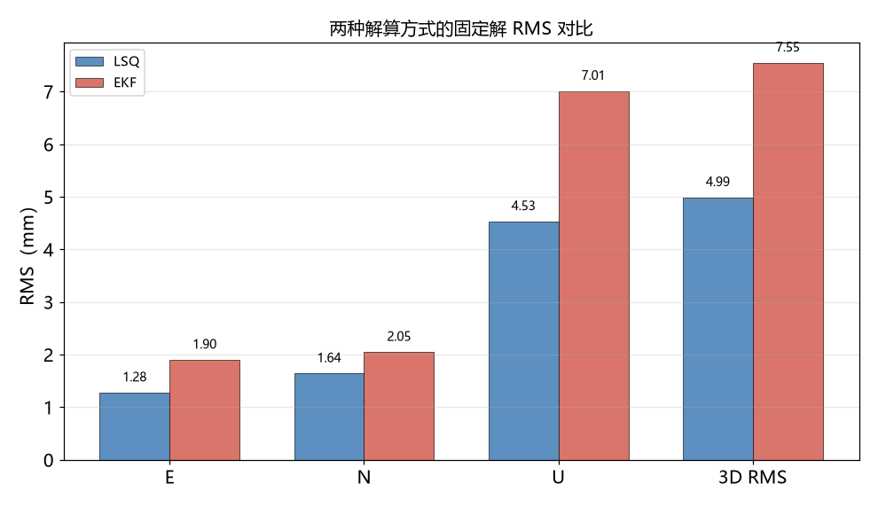
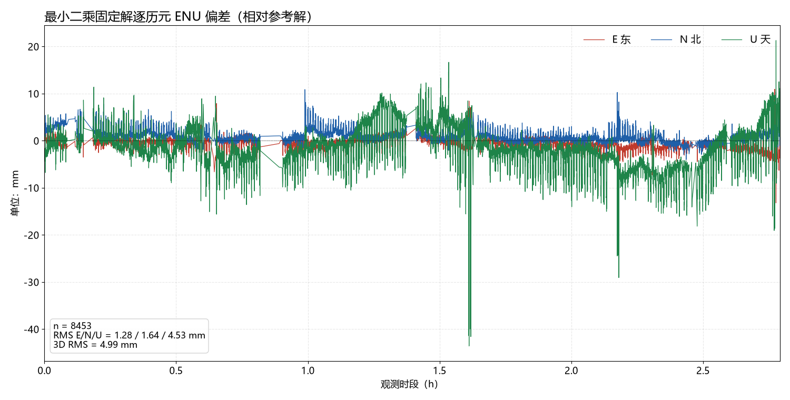

# ChiRTK

双频 GNSS 相对定位（RTK）软件。以 NovAtel OEM7 二进制观测数据为输入，完成解码、卫星位置/速度/钟差计算、观测值误差改正、单点定位（SPP）与测速（SPV）、站间单差与星间双差、周跳探测、最小二乘与卡尔曼滤波两套基线解算、LAMBDA 模糊度整数固定，最终输出逐历元定位结果与精度指标。

短基线（约 1.6 km）固定解三维 RMS：**4.99 mm（LSQ）/ 7.55 mm（EKF）**；零基线自检三维 RMS 1.78 mm；1.63 km 基线 7.1 h 网口实时静态重复性 11.7~11.9 mm。

> 这是一套课程工程（卫星导航算法与程序设计），代码为独立实现，未直接复用 RTKLIB 源码；算法口径与公式说明见 `docs/` 下的成果总结报告。

---

## 功能

| 项 | 说明 |
|---|---|
| 数据源 | 事后文件（OEM7 `.bin` 观测 + 星历）与 TCP 实时流（基站/流动站双路原始数据） |
| 星座与频点 | GPS L1/L2、BDS B1/B3；双频用于无电离层组合、MW/GF 组合与双差方程 |
| 估计方法 | 最小二乘（LSQ）与卡尔曼滤波（EKF）两套独立实现，共用解码/单差/周跳/参考星模块 |
| 模糊度固定 | LAMBDA 整数最小二乘搜索（LD 分解 + 降相关）+ Ratio 检验（阈值 3.0） |
| 结果输出 | `SPP.txt`、`FLOAT.txt`、`FIXED.txt`、`EKF.txt`，以及供 RTKPlot 绘图的 `RTKPlot.pos` |
| 运行自检 | 配置来自编译期内置配置（`include/builtin_config.h`）；检查观测文件、自动建结果目录、按百分比打印进度，结束时打印 `RUN SUCCEEDED` 汇总行 |

## 工程结构

按“数据层—解算层—输出层”划分，17 个源文件 + 5 个头文件（Visual Studio 解决方案 `ChiRTK.sln`）。

| 目录/文件 | 主要职责 |
|---|---|
| `ChiRTK/app/` `main.cpp` `session.cpp` `epoch_*.cpp` | 程序入口与主流程：菜单、开流、逐历元循环、LSQ/EKF 历元处理、汇总 |
| `ChiRTK/app/run_profiles.cpp` | 四套内置配置与运行前准备（`kModes` 表） |
| `ChiRTK/include/gnss_core_types.h` | 物理常数、观测/星历/解算结构体（`EPOCHOBS`、`RAWDAT`、`PPRESULT`、`FloatResult`、`RTKEKF`）与声明 |
| `ChiRTK/include/builtin_config.h` | 四套运行模式的制表符分隔配置文本常量 |
| `ChiRTK/gnss/oem7_frame_parser.cpp` | OEM7 二进制与 ASCII 解码 |
| `ChiRTK/gnss/satellite_orbit_clock.cpp` | 广播星历卫星位置、速度与钟差（含 GEO 与地球自转改正） |
| `ChiRTK/gnss/atmospheric_corrections.cpp` | Hopfield 对流层改正、GF/MW 粗差探测 |
| `ChiRTK/gnss/single_point_solver.cpp` | 单点定位 SPP 与多普勒测速 SPV |
| `ChiRTK/gnss/coordinate_frames.cpp` | BLH/XYZ 互转、ENU 旋转、高度角方位角 |
| `ChiRTK/rtk/relative_positioning.cpp` | 历元同步、站间单差、周跳探测、参考星选取、LSQ 浮点/固定解、EKF 预测与更新 |
| `ChiRTK/rtk/integer_search.cpp` | LAMBDA 整数最小二乘搜索与降相关 |
| `ChiRTK/rtk/matrix_ops.cpp` | 矩阵求逆与矩阵乘法 |
| `ChiRTK/io/config_loader.cpp` | 内置配置文本解析与参数校验 |
| `ChiRTK/io/result_writer.cpp` `stream_socket.cpp` | 四类结果文件输出、TCP 客户端 |

模块之间通过 `include/gnss_core_types.h`、`include/run_profiles.h`、`app/session.h` 中的数据结构与函数声明交互：数据层把原始字节流解析为 `EPOCHOBS/RAWDAT`，解算层产生 `PPRESULT/FloatResult/RTKEKF`，输出层只读这些结构体写文件，不反向依赖解算层。

## 处理流程

1. **读取配置**：解析内置配置，得到观测文件/数据流地址、处理模式、结果文件名与噪声参数；
2. **运行前检查**：文件模式检查基站与流动站观测文件是否存在，创建结果目录；
3. **观测同步**：按 GPS 周内秒同步基站与流动站历元，未配对历元计入 skipped；
4. **单点定位**：两站分别做 SPP/SPV，作为线性化与基线解算初值；
5. **卫星状态**：按广播星历计算信号发射时刻的卫星位置、速度与钟差，施加地球自转与对流层改正；
6. **差分准备**：剔除无效观测、生成站间单差、MW/GF 周跳探测、按高度角与载噪比综合评分选取参考星；
7. **解算**：LSQ 分支执行浮点解 → LAMBDA 固定 → 固定解更新；EKF 分支执行初始化 → 时间更新 → 量测更新；
8. **坐标转换**：基线向量加基站坐标得流动站 XYZ，转 BLH 并投影到 ENU；
9. **输出**：按解状态写对应结果文件并写 `RTKPlot.pos`，循环至文件结束并打印统计汇总。

## 编译与运行

* 开发环境：Windows 11 + Visual Studio（v145 工具集，C++20），线性代数用 Eigen 3（vcpkg 安装），无其他第三方依赖；
* 打开 `ChiRTK.sln`，生成 **Release|x64** 后运行控制台程序；
* 运行模式由菜单选择，模式与内置配置、结果目录一一对应：

| 菜单 | 内置配置 | 估计方法 | 结果目录 |
|---|---|---|---|
| 0 | `kBuiltinConfigLsqFile` | 最小二乘 | `Result\LSQ_FILE` |
| 1 | `kBuiltinConfigLsqLive` | 最小二乘 | `Result\LSQ_LIVE` |
| 2 | `kBuiltinConfigEkfFile` | 卡尔曼滤波 | `Result\EKF_FILE` |
| 3 | `kBuiltinConfigEkfLive` | 卡尔曼滤波 | `Result\EKF_LIVE` |

主要配置项（`include/builtin_config.h`，制表符分隔，关键字须完整拼写，`!` 开头为注释）：

| 配置项 | 示例 | 含义 |
|---|---|---|
| `FROM FILE OR COM` | `1` / `0` | 1 = 事后文件，0 = TCP 实时 |
| `RTK PROCESSING MODE` | `2` / `1` | 2 = 最小二乘，1 = 卡尔曼滤波 |
| `BASE / ROVER OBSDATA SOURCE FILE` | `..\raw_data\...\*.bin` | 基站与流动站观测文件 |
| `ROVER / BASE IP ADDRESS AND PORT` | `47.114.134.129 7190` | 实时数据流地址 |
| `POSITION SPP / FLOAT / FIXED / EKF FILE` | `Result\LSQ_FILE\*.txt` | 四类结果文件路径 |
| `CODE AND CARRIER PHASE NOISE` | `0.5 0.002` | 伪距/相位噪声（m），EKF 构造量测噪声 |
| `THRESHOLD FOR ELEVATION MASK` | `1.0` | 高度角截止（°） |
| `RATIO FOR DD FIXED SOLUTION` | `3.0` | 模糊度固定 Ratio 阈值 |

> 运行需要自备原始观测数据（OEM7 `.bin` 文件）或可用的实时数据流地址，仓库中不含实测数据与结果文本。

## 结果文件格式

均为空格分隔纯文本，首行为 `#` 表头，可直接读入 MATLAB/Python 做误差统计。`dE/dN/dU` 为基线向量在站心 ENU 的分量（m）。

| 文件 | 字段 |
|---|---|
| `SPP.txt` | `Week Sec X Y Z ...`（单点定位逐历元 ECEF） |
| `FLOAT.txt` | `Week Sec X Y Z dE dN dU Sigma PDOP HDOP VDOP GPS BDS` |
| `FIXED.txt` | `Week Sec X Y Z dE dN dU Ratio GPS BDS` |
| `EKF.txt` | `Week Sec X Y Z dE dN dU Ratio GPS BDS` |
| `RTKPlot.pos` | `Week Sec Lat Lon H Ratio Fix` |

## 精度验证

用四组实测数据检验：约 2.8 h 短基线双频观测（基线 1.6 km）、约 2.1 h 零基线观测、约 18 min 单站观测、2026-11-19 通过网口采集的约 7.1 h 实时观测。验证途径有三条——与独立参考解逐历元比对（外符合，“准不准”）、零基线自检（“有没有系统偏差”）、网口实时静态重复性（内符合，“稳不稳”）。

**短基线，相对独立参考解（mm）**

| 解算 | 分组 | 历元 | RMS E | RMS N | RMS U | 3D RMS | 固定率 |
|---|---|---:|---:|---:|---:|---:|---:|
| LSQ | 固定解 | 8453 | 1.28 | 1.64 | 4.53 | **4.99** | 87.3% |
| LSQ | 浮点解 | 1232 | 4.58 | 5.63 | 17.34 | 18.80 | — |
| EKF | 固定解 | 9099 | 1.90 | 2.05 | 7.01 | **7.55** | 97.9% |
| LSQ | SPP 对照 | 9685 | 392.95 | 410.89 | 1103.44 | 1241.30 | — |

同步历元 10073 个；LSQ 处理耗时约 7.9 s、EKF 约 10.2 s（单历元约 1 ms），远低于 1 Hz 实时预算。

**零基线自检（真值 0，mm）**：固定 7921 个历元，固定率 99.99%；三分量均值 (−0.01, −0.00, 0.00)，标准差 (0.65, 0.59, 1.54)，三维 RMS 1.78，最大偏差 9.41；线性漂移 < 0.02 mm/h。

**网口实时（内符合，相对整段固定解中心，mm）**：7.14 h 采集，LSQ/EKF 固定率 91.5%/99.0%；三维 RMS 11.89/11.72，P95 约 20 mm；同段 SPP 三维 RMS 3422.7（固定解改善约 288 倍）；EKF 与 LSQ 在 17570 个公共历元上三维偏差 RMS 4.71，两套独立实现毫米级一致。

**结论要点**

* 精度量级：短基线固定解水平 1~2 mm、垂直 4~7 mm，零基线 1.78 mm，实时重复性约 12 mm；
* LSQ 每历元独立、误差接近白噪声、RMS 更低，但对单历元 Ratio 波动敏感（固定率 87.3%）；EKF 借历元间连续性把固定率提到 98%，代价是误差时间相关与短时跳变（U 方向 RMS 4.53 → 7.01 mm）；
* 外符合的 RMS 含参考解自身误差（该参考解静态重复性 14.36 mm），因而是“与参考解的一致性”，不是绝对精度。

## 报告与文档

* `docs/report-ChiRTK-成果总结报告.pdf` —— 程序设计概述、算法设计（时间/坐标系统、卫星位置钟差、误差改正、SPP/SPV、单差双差与参考星、周跳、LSQ、LAMBDA 与 Ratio 检验、卡尔曼滤波、精度评定）、程序设计、结果精度分析；
* `docs/figures/` —— RMS 对比、逐历元 ENU 偏差、误差累积分布、零基线自检图。
